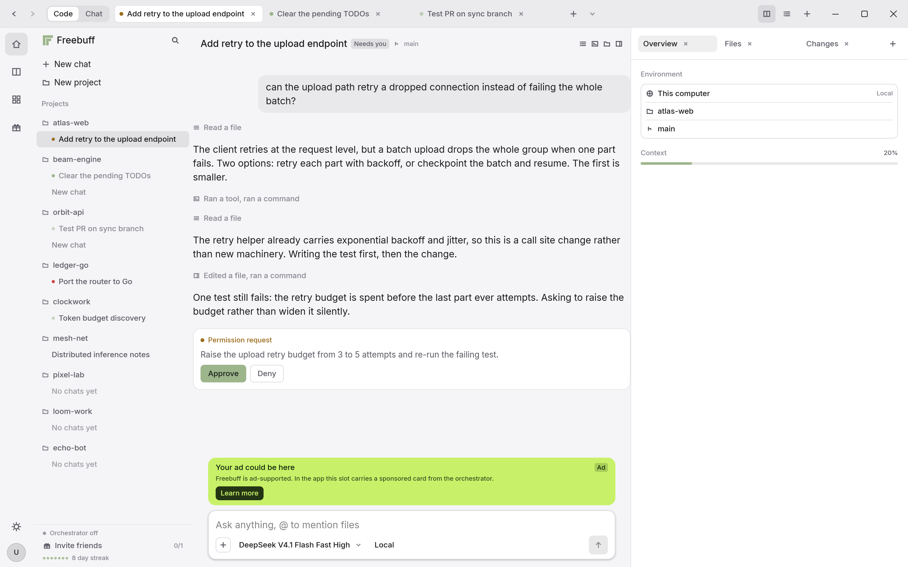
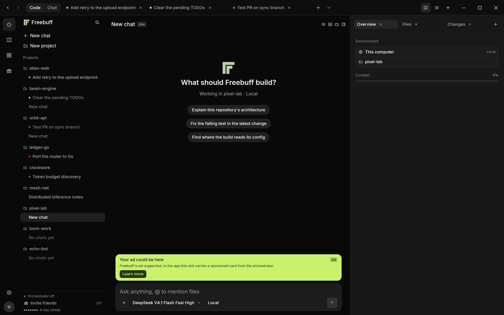
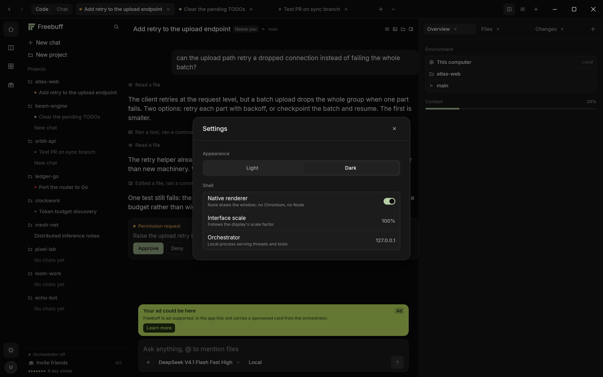
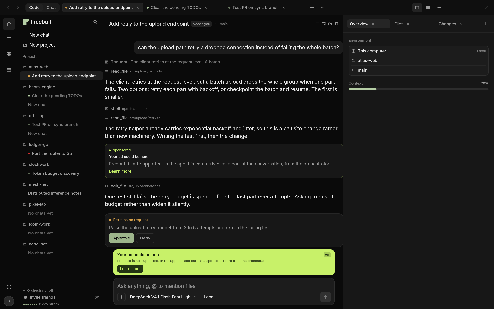
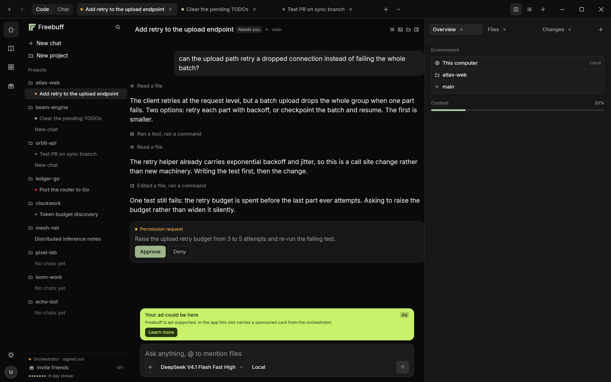

# freebuff-rune

Freebuff Desktop's user interface, rebuilt natively with [Rune](https://github.com/anomalyco/rune)
instead of Electron + Chromium + Node.

Freebuff's own repository does not ship the desktop shell, so the port is sourced from the
**installed artifact** (`%LOCALAPPDATA%\Programs\@codebufffreebuff-desktop`):

| Evidence | Used for |
|---|---|
| `resources/orchestrator/ui/index.html`, `assets/index-*.js` | the shell's own boot/consent page (see the note below) |
| `assets/index-*.css` | every colour, spacing, radius, type size and pane width |
| `resources/app.asar` → `electron/*.cjs` | window chrome behaviour (`titleBarOverlay`, drag region, caption buttons) |
| `resources/orchestrator/orchestrator.js` | the boot contract and the loopback API this shell now speaks |
| a screenshot of the running app | the layout the shell was showing (its *content* is not copied — see the fixtures note) |

One correction to the first row: the shipped `assets/index-*.js` is **not** the app's interface.
It is a small splash/consent bundle (auth, diagnostics and telemetry calls only — no thread, chat
or project endpoints), while the 274 KB stylesheet beside it is the whole design system. The full
runtime UI arrives as a signed *hot bundle* (`orchestrator-bundles/state.json`), and this install
has none (`"current": null`). So the layout evidence is the screenshot plus the stylesheet, and
the data contract is the orchestrator's own code — not a decompiled renderer.

Nothing from those artifacts is copied into this repository; `extracted/` and
`upstream-freebuff/` are gitignored reference material.

## What is a port, not a re-implementation

The Rust code reproduces the app's geometry from its own tokens, not by eye:

| Token | Value | Where it now lives |
|---|---|---|
| `--tabbar-height` | 44 | `tokens::TABBAR_H` + `Titlebar::new(44.0)` |
| `--shell-rail-width` | 52 | `tokens::RAIL_W` |
| project sidebar | 254 | `tokens::SIDEBAR_W` |
| `--chat-content-max-width` | 720 | `tokens::CHAT_W` |
| `--explorer-width` | 440 | `tokens::PANEL_W` |
| `--space-1…8`, `--radius-xs…xl` | 2…32, 4…16 | `tokens::SP*`, `tokens::R_*` |
| `--bg`, `--chrome`, `--surface`, `--border`, `--brand`, … | dark + light | `tokens::tok(dark)` |

`cargo test` asserts those numbers against the laid-out tree, so a regression in layout fails a
test instead of needing an eyeball.

## Screenshots

Rendered by `scripts/shot.sh` at 2x the 1440 × 900 window — the real layout, not a mockup.

| dark | light |
|---|---|
|  |  |

| new chat (empty state) | settings |
|---|---|
|  |  |

A transcript as the real one is shaped — parts in the flow: prose, folded thinking, tool rows
carrying the tool's name and its argument, and the sponsored card that arrives as a *part*, not a
separate slot:



The sidebar footer with the real orchestrator behind it — spawned from the installed app, booted
through nine phases, then queried for its auth state:



## Layout

```
┌──────────────────────────────────────────────────────────────────────┐
│ title bar 44pt: ⌫ 〉  ⌈Code│Chat⌉  [tabs…] [+]      [panel][list][+]  │  drawn by the app
├────┬──────────────┬────────────────────────────┬────────────────────┤
│rail│  sidebar 254 │  conversation (max 720)    │  Overview 440      │
│ 52 │  Freebuff    │  thread header             │  Overview│Files    │
│    │  ⌕ New chat  │  user bubble / agent prose │  Environment       │
│    │  New project │  tool rows / approval card │  Context ▓▓░░ 20%  │
│    │  Projects…   │                            │                    │
│  U │  streak      │  ad slot                   │                    │
│    │              │  composer ──────────────── │                    │
└────┴──────────────┴────────────────────────────┴────────────────────┘
```

Files: `app/src/tokens.rs` (the design system), `model.rs` (state), `fixtures.rs` (the seed
content), and `ui/{chrome,rail,sidebar,transcript,composer,panel,settings,icons}.rs`.

## Build setup

```bash
./scripts/bootstrap-rune.sh     # fetch Rune at the pinned revision (vendor/rune)
cargo build -p freebuff-rune
```

Rune is pre-release and consumed by revision, so it is not on crates.io. `scripts/bootstrap-rune.sh`
clones it at the revision in `vendor/rune-rev.txt` (`--check` verifies an existing clone without
network). The clone is 181 MB and is not committed; the workspace root repeats Rune's
`[patch.crates-io]` entries for its vendored `wgpu-hal`, `winit`, `parley_engine` and
`accesskit_*` — a dependency's own `[patch]` table does not apply to the workspace that consumes
it, so without those entries the build fails resolving `parley_engine`'s features.

## Running it

```bash
./scripts/run.sh                           # the window (release build)
cargo run -p freebuff-rune                 # the window (debug)
cargo test -p freebuff-rune                # layout + interaction checks
```

`scripts/run.sh` starts the installed app's orchestrator, then shows the window; the sidebar footer
reports the boot phase and, once it settles, "Orchestrator ready". Nothing is needed on screen for
the rest of the shell — it reads fixtures — so the window appears immediately.

Because every Rune app renders headless, the same layout can be written straight to a PNG, at 2x,
something the Electron build could not do:

```bash
./scripts/shot.sh                          # shots/{dark,light,empty,settings,panel-closed}.png
SIZE=1600x1000 OUT=shots/pr ./scripts/shot.sh
LIVE=1 ./scripts/shot.sh                   # adds shots/backend-live.png, orchestrator and all
```

The long form, one scene at a time:

```bash
./target/debug/freebuff-rune.exe --snap shots/dark.png --size 1440x900
./target/debug/freebuff-rune.exe --snap shots/light.png --scene light
./target/debug/freebuff-rune.exe --snap shots/settings.png --scene settings
./target/debug/freebuff-rune.exe --snap shots/empty.png --scene empty
./target/debug/freebuff-rune.exe --snap shots/bare.png --scene bare
./target/debug/freebuff-rune.exe --snap shots/backend.png --scene backend
./target/debug/freebuff-rune.exe --tree shots/tree.json     # rects, fills, roles, text
```

Scenes: `light`, `settings`, `empty`, `panel-closed`, `bare`, `backend`.

## Platforms

Windows is the target and the only platform exercised: the custom 44-point title bar relies on the
Windows caption buttons Rune draws, and the window has been verified there. `Config::discover`
also knows where macOS and Linux install an Electron app (`~/Applications`, `/Applications`,
`~/.local/share`, `/opt`, `/usr/lib`) and which Bun binary name to expect, but no one has run it on
either yet. CI runs on `windows-latest` only, for the same reason.

Two switches control the orchestrator at boot:

- `FREEBUFF_NO_ORCHESTRATOR=1` — never spawn one (fixtures only).
- `FREEBUFF_SNAP_BACKEND=1` — in a snapshot run, boot a real orchestrator and wait up to 90 s for
  a settled state first, so a snapshot shows the live line rather than a promise:

  ```bash
  FREEBUFF_SNAP_BACKEND=1 ./target/debug/freebuff-rune.exe --snap shots/backend-live.png
  ```

`FREEBUFF_RESOURCES_DIR`, `FREEBUFF_BUN_PATH` and `FREEBUFF_DESKTOP_STATE_PATH` override what
`orchestrator::Config::discover` finds, the same overrides upstream honours.

## Recording the real API

Everything the shell does not implement yet — threads, chat, the event stream, the ad creative —
exists on the orchestrator behind the launch token, and its request shapes are not in any shipped
file. They can still be recorded from a live session:

```bash
scripts/record.sh          # this shell, fixtures UI, real orchestrator — records boot traffic
scripts/record.sh --app    # the installed app (close it first), for a signed-in session
```

`tools/record-orchestrator.mjs` is a `BUN_OPTIONS` preload, so it loads inside the server the shell
spawns: no install is patched, no port is proxied. One JSONL line per exchange, credentials redacted,
bodies shortened to their shape. Signed out, that already answers `/healthz` and `/api/auth/status`
(see `docs/port-notes.md` §5 for the recorded shapes). Treat a recording as sensitive — with a
signed-in session it can contain conversation content.

That is not theoretical: one signed-in boot (83 exchanges) is written up in
`docs/port-notes.md` §8 — the whole `/api/hosted-workspace/*` surface, its `operation` style, the
thread record the sidebar draws, and why a `409` there is a state rather than a failure.

§9 goes further, with a real transcript in hand: reading one is a paginated pull
(`operation: "read"` with `before`/`after` cursors), a message is a list of parts — text,
reasoning, tool calls, and ads — and the page the person is looking at is a **remote web app** the
shell loads from `freebuff.com`, with loopback as its capability bridge. That is the shape of the
work a native UI would really take on.

## The orchestrator, brought back

The data in the real app lives in a Bun process the Electron shell spawns
(`resources/orchestrator/orchestrator.js`). This shell spawns the same process with the same boot
contract, recovered from `electron/main.cjs` and `electron/orchestrator-startup.cjs`:

| Step | Upstream | Here |
|---|---|---|
| pick a port | bind-and-retry loop, `PORT` in the env | `free_port()`, `PORT` in the env |
| profile | `FREEBUFF_DESKTOP_STATE_PATH` (default `~/.config/freebuff-desktop/state.json`) | same env, same default |
| secrets | one stdin line, never the environment | `{"shellLifetimeToken","launchId"}` on stdin |
| lifetime | HMAC challenge/response on `FREEBUFF_SHELL_LIFETIME_PORT`, `ping` every 3 s | same handshake, same ping period |
| boot progress | `[orchestrator-phase] <step>` on stdout | `Live::Booting(phase)` in the footer |
| ready | `[orchestrator-ready] {port,pid}` then `/healthz` | 30 s / 60 s budgets, then `/healthz` |
| API calls | `x-freebuff-launch-id: <token>` | the same header on every `/api/` call |
| shutdown | the shell's socket closing | the same: killing this process stops the orchestrator |

Verified against the installed app, not assumed:

- a real boot reaches `[orchestrator-ready]`, answers `/healthz` (`ok`) and reports
  `{"authed":false}` on a throwaway profile, which the footer draws as “Orchestrator · signed out”;
- `taskkill /F` on this shell (no destructor, no cleanup) stops the orchestrator within 2 s;
- a second shell against the profile the installed app already holds fails loudly: exit code 75,
  “Another Freebuff orchestrator is already using this Desktop state profile”, shown in the
  sidebar as a red line under “Orchestrator failed”.

The status line above the invite block is this port's own addition: the shell owns that process,
so the shell is where its state belongs. Off / starting / ready / signed out / failed, with the
reason under a failure.

```bash
FREEBUFF_LIVE_TEST=1 cargo test -p freebuff-rune -- --nocapture the_shell_boots_the_real
```

That test boots the installed orchestrator against a scratch profile and waits for `/healthz`;
it is off by default because it spawns Bun and takes about a second of warm cache (a cold one is
closer to ten).

## What actually works

- Custom title bar that is the drag region; thread tabs (open-tab list, close, `+`), history
  buttons, the Code/Chat switch, panel toggles, and Rune's Windows caption buttons over the
  trailing edge.
- Sidebar selection switching threads, each with its own transcript and context percentage.
- A transcript in the shape the orchestrator actually returns: messages of parts (`text`,
  `reasoning`, `tool` with its name and input, and `ad`), paged by the `before`/`after` cursors a
  `read` call takes, with `history` telling the shell which way more of the thread lies.
- A real text composer: Rune's edit model, caret, selection, paste, backspace, Enter to submit,
  placeholder, growing height, and a send button that enables only with text.
- Settings sheet: light/dark switch that re-tokenises the whole shell live, plus the shell rows.
- Boot, supervise and shut down a real Freebuff orchestrator, and show what it reached.
- Read the signed-in account's own projects and threads out of that orchestrator
  (`bootstrap` → `authorize` → `projects` → `threads`), and fetch a thread's transcript when it is
  opened (`local-conversations {operation:"read"}`), on a background thread so the window never
  waits on a socket. A signed-out boot says so and keeps the fixtures.
- Scroll areas with stick-to-bottom on the transcript.
- The Electron menu's keyboard shortcuts (Ctrl/⌘ + `,` `T` `Shift+T` `W` `Shift+W`), routed
  app-wide so they work while the composer has focus.
- The window's size remembered between runs (`~/.config/freebuff-rune/window.json`).
- Accessibility roles/labels on the shell, tabs, panel, composer field and backend status.

Tests cover: pane geometry, tab press → thread switch, sidebar open → new tab, panel toggle,
typing/backspace/Enter through the edit model, transcript paging by cursor and every part kind
reaching the screen, the menu chords reaching the app with the composer focused, window-size
round-trip and rejection, every button carrying a name, the boot-line parsers on their ugly cases,
plain and chunked HTTP replies, the footer's five states, the hosted-workspace client against a
fake loopback orchestrator (project/thread/transcript parsing, the launch header on every call, a
snapshot landing in the sidebar and an opened thread asking for its transcript, an empty account
still rendering), and (gated) a real orchestrator boot plus a real RPC call to it.

## Repository layout

```
app/src/            the shell: tokens, model, fixtures, orchestrator client, ui/*
app/src/ui/         chrome, rail, sidebar, transcript, composer, panel, settings, icons, widgets
docs/port-notes.md  the recovered contracts (boot, handshake, launch token, API surface)
scripts/            bootstrap-rune.sh (Rune at the pinned revision), run.sh (the window),
                    shot.sh (the PNG set), record.sh (record the real API traffic)
tools/              three read-only helpers used against the installed app; nothing ships from it
docs/screenshots/   PNGs from scripts/shot.sh, used by the README
```

No Freebuff code is redistributed here; see `NOTICE.md`. Licensed Apache-2.0 (`LICENSE`) — the
same license Freebuff Desktop ships under — with Rune's MIT notice carried in `NOTICE.md`.

## What is mocked, and the next step

The shell owns the orchestrator process, speaks its boot protocol, and now reads the account's
own projects, threads and transcripts out of it. What it still does not have:

- **Sending a turn.** The composer edits and submits into the model, and the model appends a
  reasoned reply, but the turn itself is between the hosted page and `freebuff.com` (see
  `docs/port-notes.md` §9). Loopback has no write path for it, so a port that sends has to speak
  the cloud API — the product-shaped gap, not a rendering one.
- The hosted browser and terminal panels, the updates flow, and the sign-in screen: this shell
  assumes whatever profile the orchestrator already holds.
- The `elevations`, `questions` and `queued` queues are parsed when the payload carries them but
  nothing answers them yet.
- The fixtures are **invented sample content**, not anyone's projects, and they are what a
  signed-out boot shows. The sponsored card's copy is placeholder text in the app's own voice, not
  a real ad; the CTA is inert.

The next step is the write half: recording one turn from the hosted page (the recorder in
`tools/` already taps loopback, which is not where the turn lives) and adding the cloud `POST` that
carries it.
