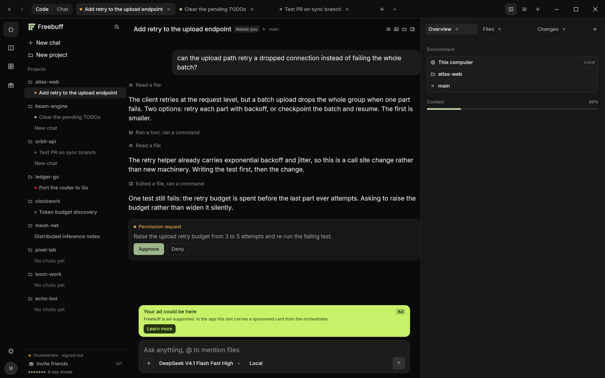
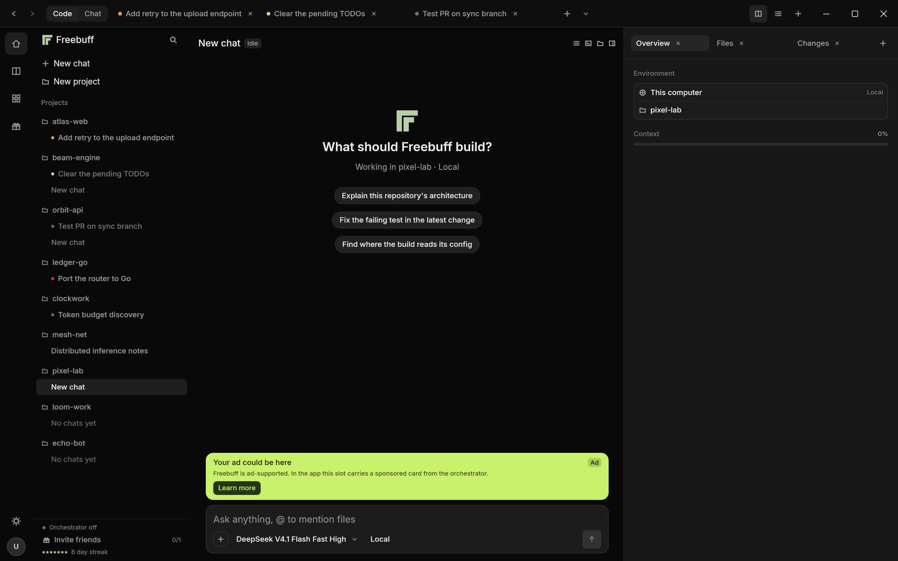
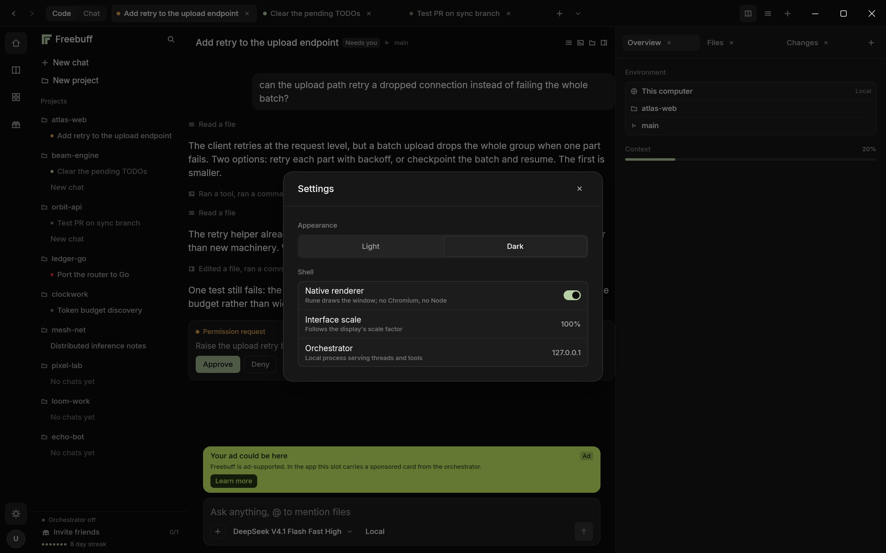

Prototype is up, so the claims in the issue can be checked rather than taken on trust:

**<https://github.com/phantomic12/freebuff-rune>**

It is a port, not a redesign: the panes, spacing tokens, palette and geometry come from the shipped
stylesheet, and the title bar is the same 44-point band. What is new is everything under it —
Rune draws the whole shell with wgpu instead of Chromium, and there is no Node, no Electron and no
webview anywhere in the process tree.


The sidebar footer is the only part that talks to the real backend. It spawns the installed app's
own Bun orchestrator, sends the launch id over stdin, answers the HMAC lifetime challenge and pings
it every 3 s; the line below reads `Orchestrator · signed out` after a real boot, which is what
`/api/auth/status` answers on this machine:



Killing the shell stops the orchestrator within ~1 s, and starting a second shell against the same
Desktop profile is refused with the same exit code 75 the Electron shell gets:

| | |
|---|---|
|  |  |

Being a Rune app, it also renders headless, so every one of those images is a command rather than a
screenshot tool — and the same run can dump the layout tree the tests assert against:

```bash
./scripts/shot.sh        # the PNG set above, at 2x
./scripts/run.sh         # the window
```

What it does *not* do yet, so nothing here is overclaimed: threads, streaming replies and the ad
creative are fixtures. The shipped local route table only exposes `appearance`, `auth`, `hosted
workspace` and `diagnostics`, so the thread/chat/event request shapes are not recoverable from the
install — the honest fix is to record one real exchange per feature and write the client against
that. The contract in #1686 is what makes that a documented step instead of a guess.

Happy to keep this as documentation if the direction is not wanted; the shell itself lives outside
this repo and needs no decision from you.
